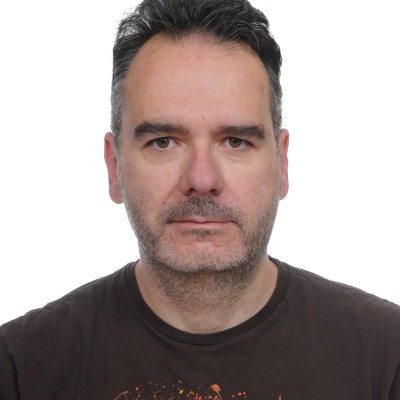
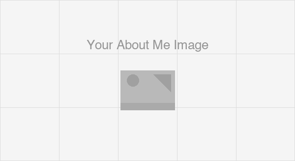

---
hide:
  - toc
  - navigation
---
<!--
CHECKLIST FOR THIS PAGE:
- [ ] Replace [YOUR NAME] with your full name (3 places)
- [ ] Replace [YOUR JOB TITLE] with your current or target role
- [ ] Replace [YOUR TAGLINE] with a short phrase describing your focus
- [ ] Rewrite the About Me paragraph with your own words
- [ ] Replace assets/images/profile.png with your actual photo (keep the filename or update it below)
- [ ] Replace assets/images/about.png with your own image (a field photo, map, or workspace shot)
- [ ] Edit the skill cards to match your actual skills (add, remove, or rename cards as needed)
- [ ] Update GitHub and LinkedIn links in the Connect section
- [ ] Add your CV PDF to docs/assets/ and update the filename in the Download CV button
-->

  
  <h1>Dimitris Vlachos</h1>
  
<strong>GIS Engineer</strong>

  
<em>[YOUR TAGLINE — Test]</em>

---

## About Me

I’m a GIS engineer and NTUA-trained surveyor based in Athens. Since 2021 I have run a geoportal of 3,000+ layers across 50+ fiber-installation projects in Greece, Germany, the Netherlands and Austria, using QGIS and GeoServer. Before that, I spent over a decade in the field, working with GPS, total stations, laser scanning, drone mapping and thermal imaging, staking out boundaries and construction elements for solar parks and designing their earthworks and internal roads. I work in Greek, English and German.

  

---

[View My Projects :material-arrow-right:](projects/index.md){ .md-button .md-button--primary }
[Download CV :material-download:](assets/CV_Vlachos_Dimitris.pdf){ .md-button }

---

## Skills

-   :material-layers:{ .lg .middle } **GIS**

    ---

    - QGIS
    - GDAL / OGR, GRASS GIS
    - Autocad
    

-   :fontawesome-solid-martini-glass:{ .lg .middle } **Surveying**

    ---

    - GNSS
    - Total station
    - Georadar
    - Drone 
    - Laser Scanner
   

-   :material-earth:{ .lg .middle } **Web Mapping & Data**

    ---

    - Leaflet.js, OpenLayers
    - Geoserver
    - Data formats — GeoTIFF, GeoParquet, NetCDF
    

-   :material-database:{ .lg .middle } **Utility detection**

    ---

    - Processing 3rd party drawings
    - Georadar measurements
    - Processing Georadar data in dedicated (software)

-   :material-airplane:{ .lg .middle } **Drone / UAV Data Processing**

    - Mission planning and flight operations
    - Photogrammetry: Agisoft Metashape, OpenDroneMap
    - Point cloud processing: CloudCompare, PDAL

---

## Connect

[GitHub](https://github.com/dvlahos82){ .md-button }
[LinkedIn](https://linkedin.com/in/dimitris-vlachos-39589a136){ .md-button }
